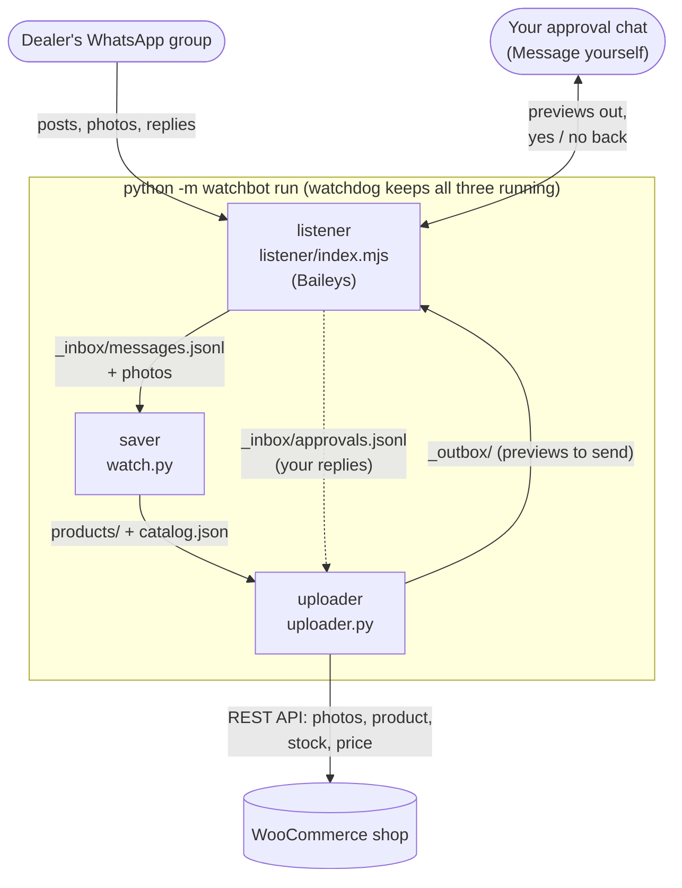
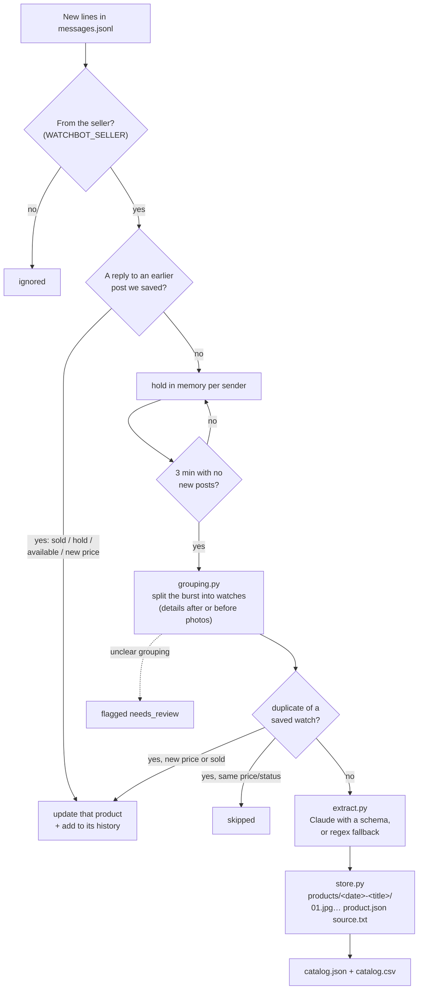
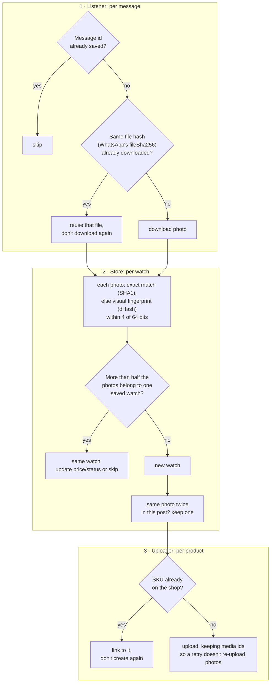
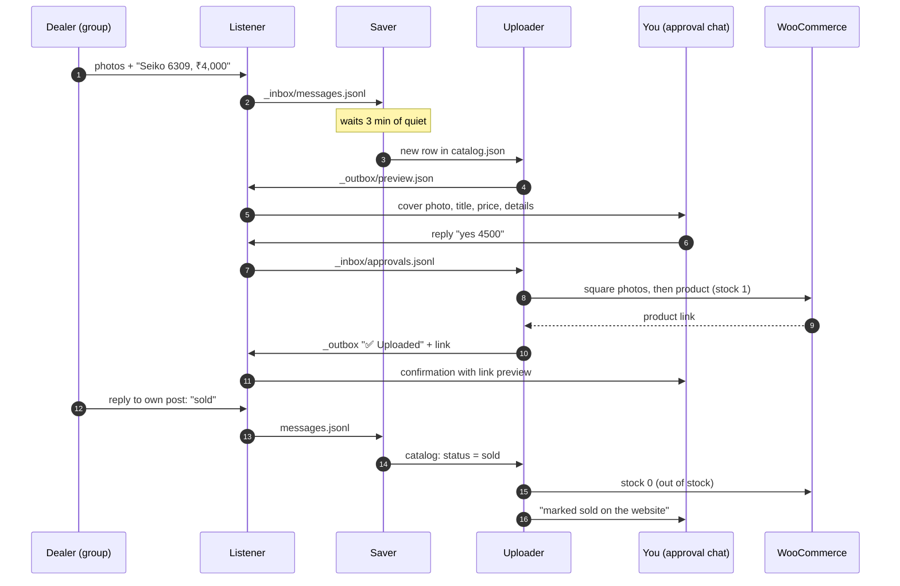
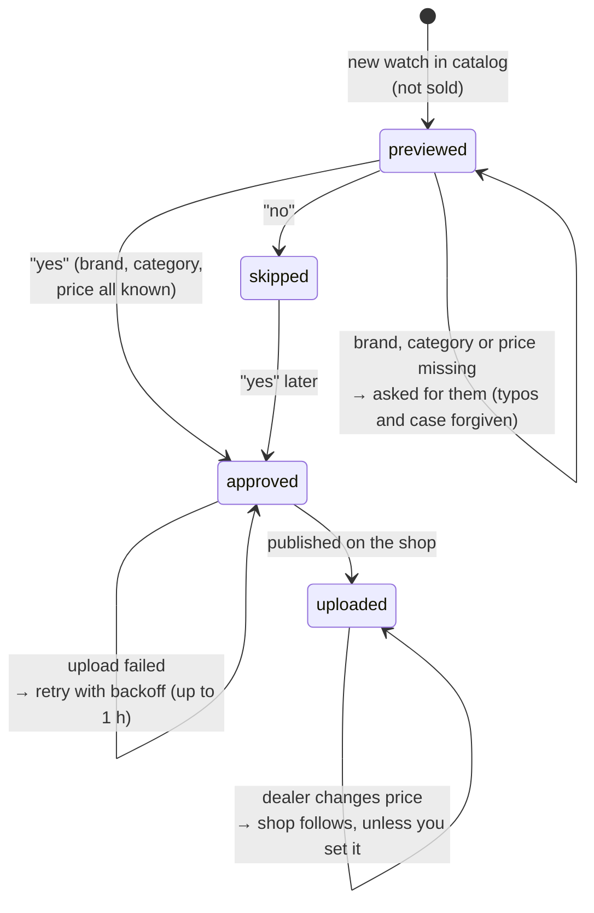
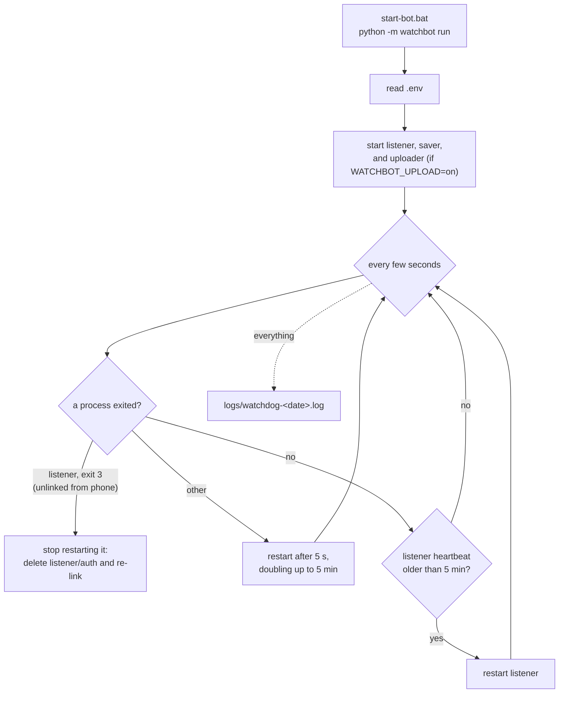

# How watchbot works, in diagrams

1. [The whole system](#1-the-whole-system)
2. [From messages to a product](#2-from-messages-to-a-product)
3. [Duplicate checks](#3-duplicate-checks)
4. [Approval and upload](#4-approval-and-upload)
5. [Life of an upload](#5-life-of-an-upload)
6. [The watchdog](#6-the-watchdog)

All the processes talk through plain files in the output folder (`WATCHBOT_OUT`), never directly to each other. That means any one of them can crash or restart without losing anything: each one keeps its own read position.

## 1. The whole system

Files the processes share: `_inbox/` (messages, photos, approvals, heartbeat), `products/` and `catalog.json`/`catalog.csv`/`state.json` (the saved watches), `_outbox/` (messages waiting to be sent), and `uploads.json` (what's on the shop).

The other two inputs skip the listener and go straight to the same pipeline: `python -m watchbot ingest export.zip` for a chat export, and `python -m watchbot serve` for the forwarding bot on the official Cloud API.

## 2. From messages to a product

## 3. Duplicate checks

Duplicates are stopped at three points, from cheapest to most thorough.

The visual fingerprint catches photos that WhatsApp recompressed or resized when the dealer re-posted them. The "more than half" rule still catches a re-post with one photo swapped, but a new listing that only shares a stock shot (box, papers) isn't mistaken for an old one.

## 4. Approval and upload

## 5. Life of an upload

The states kept in `uploads.json`:

A reply can carry details in any order and spelling (`yes brand omga catagory swis 4.5k`). Details sent without a "yes" are noted, and the watch waits for the "yes"; a "yes" sent while something is still missing is remembered, so the upload starts as soon as the last missing detail arrives.

Website price = dealer price × (1 + `MARKUP_PERCENT`/100) + `MARKUP_FLAT`, rounded up to `PRICE_ROUND`. If you approved with your own price (`yes 4500`), later dealer price changes are reported to you instead of applied.

## 6. The watchdog

A process that has stayed up for 10 minutes has its restart delay reset to 5 seconds. There's no heartbeat check while the listener is showing a QR code.
